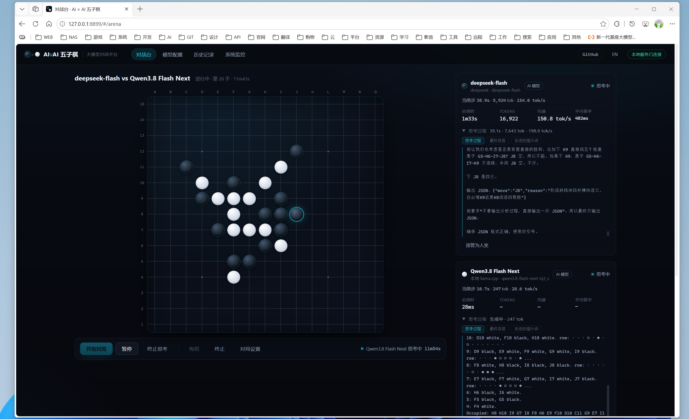

# AI × AI Gomoku · LLM Battle Platform

[简体中文](README.md) | **English**

Let multiple AIs (or humans, or built-in algorithms) play Gomoku against each other, while recording every performance detail: thinking time, time-to-first-token, token usage and speed, MTP draft acceptance rate, CPU/GPU load, and more.

> **Live demo**: <https://yutils.github.io/ai-gomoku-arena>

- **Pick each side independently**: any AI model / built-in algorithm (three difficulty levels) / human
- **Watch thinking live**: stream the model's reasoning, and expand the raw thought for each move
- **Real metrics**: per-move and cumulative time, TTFT, input/output tokens, tok/s, cache hits, MTP drafts
- **History & replay**: every match's moves, metrics and reasoning are kept — replay, import and export
- **System monitor**: llama.cpp service (`/props` `/slots` `/metrics`) plus local CPU/GPU/VRAM/processes

#### screenshot


## Is this a static website? Does it need building?

**The frontend is 100% plain static pages**: no framework, no build step, no npm dependencies. `index.html + css + js` are loaded directly by the browser and work offline.

The only "server" in the project is a **zero-dependency, single-file Node script** [server/server.js](server/server.js) that does just three things:

1. Serve the static pages above (equivalent to an http-server)
2. **CORS proxy** at `/proxy`: some inference services (e.g. Strata) don't return cross-origin headers, so the browser blocks direct calls — relay them through here instead
3. **System info** at `/api/sysinfo`: use Node + Windows performance counters to collect CPU / memory / GPU usage and llama-server process data

So: **no building, no bundling, no `npm install` required**. Any Node (≥ 18; tested on v24 locally) can run it directly.

Three ways to deploy:

| Method | Command | What you get |
|---|---|---|
| Local use (recommended) | Double-click `启动服务.bat`, or `node server/server.js` | All features (proxy + system monitor) |
| LAN access | Listens on `0.0.0.0` by default; other devices open `http://<your-ip>:8899` | All features (allow through Windows Firewall on first run) |
| Pure static hosting (Nginx / GitHub Pages, etc.) | Deploy only `index.html css/ js/` | Pages work, but **lose** the CORS proxy (services like Strata won't work) and CPU/GPU monitoring |

To restrict access to the local machine: `HOST=127.0.0.1 node server/server.js`; to change the port: `node server/server.js 9000`.

## Quick start

```bat
启动服务.bat          :: same as node server/server.js, and opens the browser automatically
:: http://127.0.0.1:8899
```

**Nothing is pre-configured on first open — you add it yourself** (config is stored only in your own browser):

1. Open "Models" → "New provider", fill in the Base URL (point it at `/v1`) and API Key; "Fetch available models" probes `/v1/models`
2. Add or pick the models you want in the model list (model ID, context window, max output, etc.)
3. Save, then go to the "Arena": choose the Black and White players (AI model / classic algorithm / human) and click "Start match"

## Connecting to any model service

The "Models" page follows the model-config design of DeepSeek Harness:

- **Provider**: ID (immutable after creation), display name, Base URL (point it at `/v1`), API protocol (OpenAI Chat Completions), API Key, network policy, timeout, custom request headers, extra request parameters
- **Model**: model ID, display name, context window, max output, temperature / top_p / top_k, whether it's a reasoning model
- "Fetch available models": probes `/v1/models`; "Connectivity test": sends a real request to measure latency and speed

Key points:

- **The API Key is stored only in your browser** (localStorage) and is never shown in plain text after saving; exported records **never** contain any key
- **Network policy**: `Auto` (try direct first, switch to the local proxy when blocked by CORS), `Always via local proxy` (pick this when the service has no CORS headers, e.g. Strata), `Always direct` (when the service supports CORS, e.g. llama.cpp with its default `--cors-origins *`)
- **Extra request parameters** (JSON, merged into the request body): strongly recommended for reasoning models as needed — it can greatly speed things up
  - `{"chat_template_kwargs": {"enable_thinking": false}}` — disable long thinking (llama.cpp + Qwen family templates)
  - `{"reasoning_effort": "low"}` — lower the reasoning effort (services that support this parameter)
- Start **llama.cpp** with `--metrics` so the monitor page can show full metrics such as token counts, KV cache, request queue and MTP draft acceptance rate (it works without it — just with fewer metrics)

#### screenshot


## Match mechanics

- 15×15, no forbidden moves (size selectable: 13/15/19); Black moves first; win with five or more in a row horizontally, vertically or diagonally; a full board is a draw
- Participants: **AI model** / **built-in algorithm** (Beginner = random preference, Medium = heuristic attack/defense, Hard = Minimax α-β) / **human**
- Control bar: Start / Pause / Resume / Undo / Stop / Rematch; at any point during a match you can "take over as human" for either side, and later "restore AI"
- Rules and fault tolerance (configurable in "Match settings"):
  - Per-move timeout (default 600s): the overall cap for one whole move; an individual request only times out when no data arrives for a long time, so a model that is still streaming won't be cut off
  - Illegal-move retries (default 10): feed the occupied/out-of-bounds info back to the model so it can give new coordinates
  - On error: **built-in algorithm fallback move** (marked "fallback") or **immediate loss**
  - Prompt language: follows the UI language (toggle at the top right); whether the model must analyze the position first (thinking mode)
  - During a match you can click "Stop thinking" to cut off the current reasoning immediately and salvage a move from the output produced so far
  - When model output is truncated by length, the parser automatically falls back to the last coordinates found in its reasoning

## Metric definitions

- Per move: total time, TTFT (time to first token), input/output tokens, generation speed (tok/s), prompt processing speed, cache-hit tokens, MTP draft/accept counts
- Prefer the server-returned `usage` / `timings` (both llama.cpp and Strata return them); when the server doesn't return them, estimate by character count and mark with ≈
- Cumulative: total time, total tokens, average speed and average TTFT per side; the History page has a side-by-side summary

## System monitor

- **Service data**: `/props` (model file, context, build version), `/health`, `/slots` (slot usage/status/MTP), `/metrics`
- **Local resources**: CPU (model/cores/usage), memory, GPU (total usage + per-engine breakdown + VRAM/shared memory), llama-server process (memory/CPU/VRAM/GPU usage)
- Collection method: Node `os` module + Windows performance counters (`Get-Counter`); AMD / Intel / NVIDIA GPUs are all supported (tested locally on AMD Radeon 780M)

## Directory structure

```
AIvsAI/
├── index.html                 # Single-page entry (four views: Arena / Models / History / Monitor)
├── css/main.css               # Design system (dark tech style, no external dependencies)
├── js/
│   ├── core/board.js          # Board, win detection, coordinate conversion (A-O × 1-15)
│   ├── core/game.js           # Match state machine: alternating thinking/retry/fallback/undo/takeover/stats
│   ├── ai/openai.js           # OpenAI-compatible streaming adapter (SSE/TTFT/proxy fallback/timeout)
│   ├── ai/prompt.js           # Prompts and board serialization (Chinese/English)
│   ├── ai/parse.js            # Move parsing (JSON / MOVE: / bare coordinates / digit pairs)
│   ├── ai/engine.js           # Classic algorithms (heuristic + Minimax, run in a Worker)
│   ├── store/providers.js     # Provider/Model/Key config storage and model discovery
│   ├── store/db.js            # IndexedDB history
│   └── ui/                    # Four pages + board component + mini charts
├── server/server.js           # Zero-dependency helper service (static hosting / CORS proxy / system info)
├── tests/                     # node:test unit tests (board/parsing/algorithms)
├── 启动服务.bat               # One-click start and open browser
├── LICENSE                    # MIT License
└── package.json               # Only for npm test and npm start, no dependencies
```

## Tests

```bat
npm test        :: node --test, 24 cases (board/win/coordinate parsing/move parsing/algorithm attack & defense)
```

## FAQ

| Symptom | Cause and fix |
|---|---|
| Calling a model reports "network request failed" | The service has no CORS headers. In "Models", change that service's network policy to "Always via local proxy"; also make sure the page was opened through this service (the top pill shows "Local service connected") |
| The top pill shows "Local service disconnected" | You opened the page via file:// or another static server. Use `启动服务.bat` / `node server/server.js` instead |
| The monitor page says "requires --metrics" | Add `--metrics` to the llama-server launch args and restart |
| The monitor page says "cannot connect" | llama-server isn't running, or the address/port is wrong; make sure `/health` is reachable |
| Frequent "fallback move" during a match | The model is too slow or keeps giving illegal coordinates: increase the per-move timeout, lower max output, or disable thinking mode as described above; the quantized model may also simply be limited |
| Port 8899 is in use | `node server/server.js 9000` to change the port |
| LAN devices can't open it | On first run, allow Node to access the private network in the Windows Firewall popup; and make sure you use `http://<your-ip>:8899`, not 127.0.0.1 |
| History disappeared | Records live in the browser's IndexedDB; clearing browser data or switching browsers loses them — use "Export all" on the History page to back up |

## Security notes

- This is a **local tool**: the API Key lives only in your own browser's localStorage, and the server stores no keys
- If it listens on `0.0.0.0` (the default), other devices on the LAN can also use `/proxy` (which can forward arbitrary http/https requests) and system info — **use it only on a home/trusted intranet**; when not needed, restrict to the local machine with `HOST=127.0.0.1 node server/server.js`

## License

Released under the [MIT License](LICENSE).